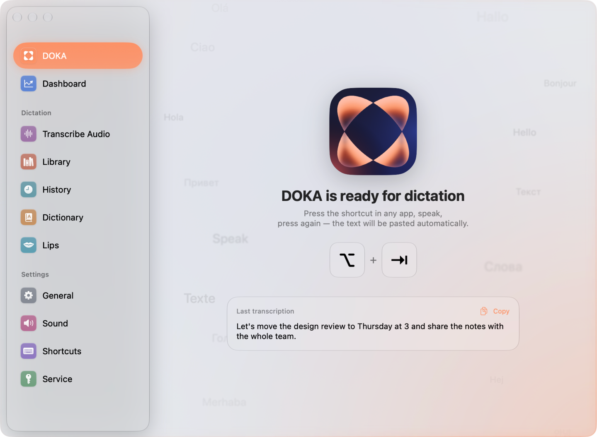
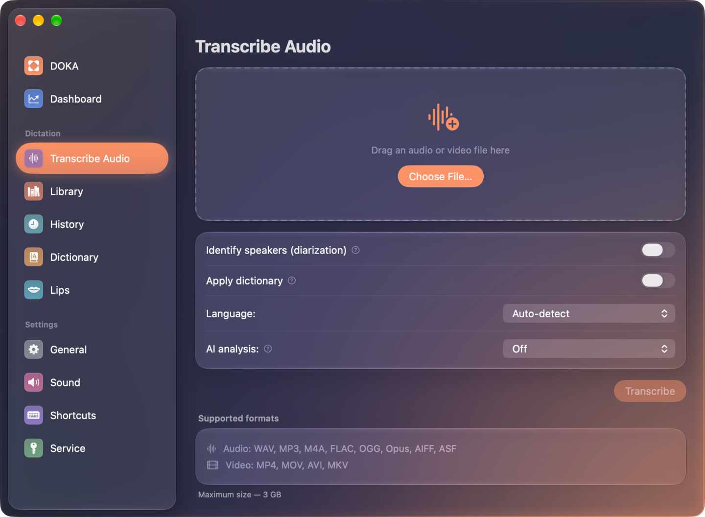
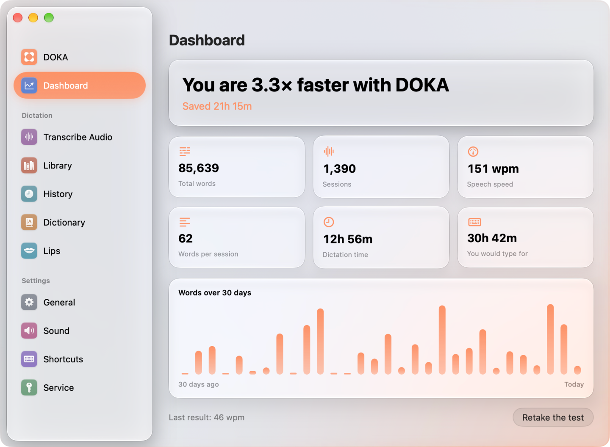
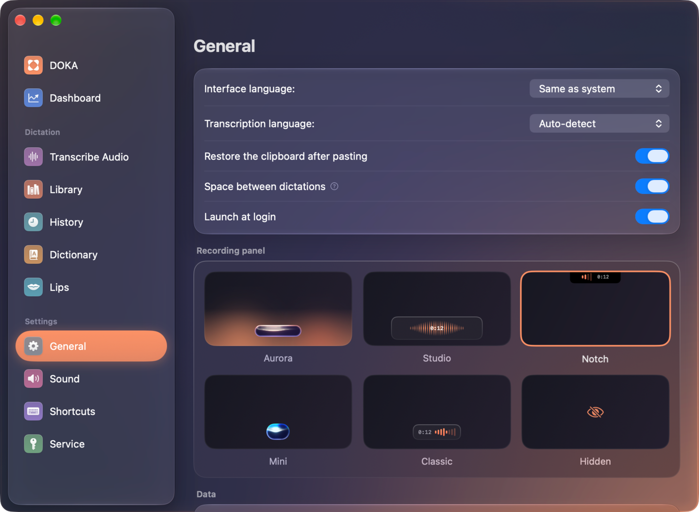

<p align="center">
  
</p>

<h1 align="center">DOKA</h1>

<p align="center">
  <b>Voice dictation and transcription for macOS — on your Mac, in any app.</b><br>
  Press a hotkey, speak, and the text lands where your cursor is. Private by default.
</p>

<p align="center">
  <b>English</b> · <a href="README.ru.md">Русский</a>
</p>

<p align="center">
  <a href="https://github.com/ippitenin/DOKA-macOS/releases/latest"></a>
  <a href="https://github.com/ippitenin/DOKA-macOS/actions/workflows/build.yml"></a>
  
  
  <a href="LICENSE"></a>
</p>

<p align="center">
  <a href="https://github.com/ippitenin/DOKA-macOS/releases/latest/download/DOKA.dmg"></a>
  <br>
  <sub>Apple silicon · macOS 15 or later · signed and notarized by Apple</sub>
</p>

<p align="center">
  
</p>

DOKA lives in the menu bar. Recognition runs **entirely on your Mac** — Whisper or Parakeet on
the Neural Engine, no internet and no API key — or through any OpenAI-compatible service. On top
of dictation it transcribes audio and video files, tells speakers apart and writes meeting
minutes with a language model that also runs locally.

## Features

<table>
  <tr>
    <td width="50%" valign="top">
      <h3>🎙️ Dictate into any app</h3>
      Hotkey, speak, hotkey again — the text is pasted where your cursor is. Push-to-talk and a mouse button work too.
    </td>
    <td width="50%" valign="top">
      <h3>🔒 Private by default</h3>
      Whisper and Parakeet run on your Mac's Neural Engine: no internet, no key, audio never leaves the device.
    </td>
  </tr>
  <tr>
    <td width="50%" valign="top">
      <h3>🎬 Transcribe audio and video</h3>
      Drop a file, get timestamped text, SRT and VTT. Jobs survive sleep, a lost network and even a restart.
    </td>
    <td width="50%" valign="top">
      <h3>👥 Speakers, on-device</h3>
      Who said what, worked out on your Mac: an hour and a half of conversation in about 12 seconds.
    </td>
  </tr>
  <tr>
    <td width="50%" valign="top">
      <h3>🧠 AI analysis on your Mac</h3>
      Meeting minutes, summaries, action items or your own prompt, written by a local model. Export to Markdown or PDF.
    </td>
    <td width="50%" valign="top">
      <h3>📚 A library with a player</h3>
      Every transcript keeps its audio: search, click a timestamp to jump there, rename speakers, fix a line, export.
    </td>
  </tr>
  <tr>
    <td width="50%" valign="top">
      <h3>🌊 A panel worth looking at</h3>
      Six recording styles, led by Aurora — a Liquid Glass droplet on Metal shaders whose wave answers your voice.
    </td>
    <td width="50%" valign="top">
      <h3>🤫 Quiet mode</h3>
      Dictate in a whisper when someone is asleep nearby. DOKA stops mistaking it for silence.
    </td>
  </tr>
</table>

<details>
<summary><b>All features in detail</b></summary>

- **Voice dictation** — global hotkey (or push-to-talk, or a mouse button) → recording →
  transcription → dictionary replacements → text pasted into the active app through the
  clipboard and a synthetic ⌘V. Two dictations in a row into the same field get a space
  between them, so the words don't run together. Optional AI cleanup on your Mac removes
  stumbles, understands self-corrections ("Wednesday, no, Thursday"), turns spoken punctuation
  into marks and follows your own wishes ("start with a lowercase letter"). When a phrase ends
  as an exclamation — the pitch drops sharply at the end — the final full stop becomes "!":
  judged by the sound, with any recognition service.
- **Recording panel** — six styles. `aurora` and `mini` are a glowing droplet built on Metal
  shaders in the spirit of Liquid Glass: the wave inside answers your voice in both amplitude
  and speed, the glass refracts light at the rim, and while transcribing the droplet springs
  into a ring of pulsing dots. `aurora` is the wide warm droplet with a halo and a soft glow
  along the bottom edge of the screen; `mini` is half as wide, painted in a cold palette (ice,
  turquoise, blue-violet) and wearing a live rim: the light of the wave bleeds onto the
  outline, runs along it in tides and splits into chromatic aberration. Plus `studio`,
  `classic`, `notch` (a strip that grows out of the camera cutout) and `hidden`.
- **Transcribe Audio** — drop in an audio or video file and get timestamped segments,
  subtitles (SRT/VTT) and optional speaker diarization. With the built-in service the job
  runs asynchronously: it survives network loss, sleep, and even an app restart — the
  result is collected without re-uploading the file or paying twice.
- **Speaker diarization, on-device** — with a local model (or your own OpenAI-compatible
  service, which has no diarization of its own) DOKA separates speakers on your Mac with
  NVIDIA Nemotron 3 Diarization: a ~220 MB model downloaded once, no internet and no
  billing. An hour and a half of conversation is split in about 12 seconds on Apple
  silicon; if you know how many people speak, the hint switches to pyannote, which
  honours an exact speaker count.
- **Transcription library** — every transcribed file is kept together with its audio:
  search by title and text, groups by date, renaming, batch export (one Markdown or .txt
  file, or separate TXT/SRT/VTT files per record). A record opens with a player: click a
  timestamp to jump there, the segment being played is highlighted and followed; space,
  ←/→ and playback speed. Running jobs show their progress; records are kept forever
  unless you choose a retention period.
- **Retry and re-transcribe** — a job that failed or was cancelled is resumed from the record
  itself: when the server has already finished (and charged for) the result, it is collected
  without uploading anything again; otherwise the file is sent once more, and a paid service
  asks for confirmation first. Any record can also be re-transcribed by another service — the
  new result appears next to the original, which stays untouched. A failed dictation gets its
  own menu-bar entry, so fixing the network still lands the text in the app you were in. If a
  transcription finishes while you are looking elsewhere, a notification opens the record.
- **Speakers and text editing** — rename speakers ("Speaker 1" → "Anna"), merge two
  speakers into one and split them back, reassign a line (or part of a long one) to
  another speaker, fix the text of a line with a double click. Edits survive any timestamp
  detail level, reach copying and every export format, and can be undone line by line or
  all at once; the original recognition result is never overwritten. "Guess names" asks the
  local language model to find the speakers' names in the conversation (introductions and
  direct address) and notices when one person was split into two — every suggestion waits for
  your confirmation.
- **AI analysis on your own Mac** — meeting minutes, a short summary, action items, lecture
  notes, an interview breakdown, chapters, or your own prompt. The report is written by a
  language model running right on the machine (llama.cpp + Qwen3.5 4B): no internet, no key,
  no billing; the 2.7 GB model is downloaded once. A long recording is processed in parts
  and combined into a single report. Template sections can be rewritten, or you can build
  your own template; templates are exported and imported as JSON files, Memento templates
  included. The result renders as formatted text with headings, lists and tables,
  its timestamps are clickable and seek the player; copying puts both plain and rich text
  on the clipboard, so tables paste as tables into Telegram, Notes or Word; the report saves
  as Markdown, plain text or an A4 PDF with a header and page numbers. Analysis can
  be ordered right when transcribing a file — with any template or your own prompt: by
  default it runs on this Mac after recognition, and with the built-in service you can pick
  “In the cloud” (the Nexara language model) instead, so the analysis rides in the same
  request as the transcription.
- **History** — a journal of dictations with metadata, playback, export (CSV or plain text)
  and a performance analysis screen.
- **Dashboard** — words dictated, time saved, and how much faster this is than your own
  typing (measured by a built-in typing test), plus a daily chart.
- **Sound processing** — microphone volume boost while recording, silence removal before
  upload, and system sounds on key transitions.
- **Quiet mode** — dictate in a whisper when someone is asleep nearby or you can’t speak aloud.
  A whisper is recognized almost as accurately as a normal voice, and DOKA stops mistaking it
  for silence. Toggle it in Sound, from the menu bar menu or with its own hotkey.
- **Lips (experiment)** — collects “lip video + text” pairs for future lip reading. Turn it on
  in General → Advanced; it is off by default. The camera runs only while you dictate, and the
  recognized text becomes the caption for the video. While recording, a mirror slides out of
  the screen notch: a live view of your mouth that calmly follows your face, with a glowing
  lip mask in the Aurora palette (peach to indigo) drawn on the very frame it was measured
  on. Sound can’t caption silent pairs, so there is a Training window: it shows a phrase — from
  your past dictations or a built-in (Russian) list — that you mouth with your lips only, and
  the phrase itself becomes the caption. For now this only collects data — DOKA can’t read lips
  yet.
- **Dictionary** — case-insensitive replacement rules applied to every transcript. Rules match whole words: “doka” → “DOKA” no longer touches “document”; the per-rule “Inside words” switch brings back substring matching (e.g. “ё” → “е”). Optionally applied to file transcripts as well.


</details>

## A closer look

<table>
  <tr>
    <td width="33%" valign="top"></td>
    <td width="33%" valign="top"></td>
    <td width="33%" valign="top"></td>
  </tr>
  <tr>
    <td align="center"><sub>Transcribe audio and video</sub></td>
    <td align="center"><sub>How much faster than typing</sub></td>
    <td align="center"><sub>Six recording panel styles</sub></td>
  </tr>
</table>

## Privacy

The three recognition modes differ in what leaves your Mac:

| Mode | What leaves your Mac |
|---|---|
| Local models (Whisper, Parakeet) | **Nothing.** Audio never leaves the device, and no key is needed — speaker diarization and AI analysis of the transcript included |
| Built-in service (Nexara) | Audio is uploaded to `api.nexara.ru` for recognition |
| Custom OpenAI-compatible service | Audio is uploaded to the endpoint you configure |

Everything else stays local. Transcript history, statistics and the transcription library
(with compressed audio of transcribed files — can be turned off in General → Advanced)
live in `~/Library/Application Support/DOKA`. Storing dictation audio is **off by default**;
when enabled, recordings are kept locally as m4a and pruned on a schedule you choose. API
keys live in the macOS Keychain, never in config files.

The Lips experiment films your face only if you turn it on yourself. Face video is biometric
data: it is stored in `~/Library/Application Support/DOKA/LipData`, never uploaded and never
deleted automatically. You can erase all of it with one button in the Lips section.


## Recognition services

Pick one on first launch, or later in the **Service** section:

| Service | API key | Notes |
|---|---|---|
| Whisper Large v3 Turbo (Local) | not needed | ~1.6 GB one-time download, runs through WhisperKit on the Neural Engine |
| Parakeet TDT 0.6B v3 (Local) | not needed | ~700 MB, runs through FluidAudio |
| Built-in (Nexara) | required | adds recording-type presets, speaker roles, analysis ordered with transcription, and async jobs |
| Custom service | required | any OpenAI-compatible `/audio/transcriptions` endpoint |

Speaker diarization and AI analysis work with every service: whatever the service does not do
itself runs on your Mac.

A cloud service occasionally slips: a long dictation comes back as one or two sentences, or, with
the language set to "Auto", a Russian phrase arrives as an English translation. DOKA double-checks
such an answer on your Mac with the Parakeet model (if it is downloaded) and, when needed, repeats
the request once.

## Install

1. Download **[DOKA.dmg](https://github.com/ippitenin/DOKA-macOS/releases/latest/download/DOKA.dmg)** from the latest release.
2. Open it and drag DOKA to Applications.
3. Launch it — DOKA appears in the menu bar. The first launch walks you through three steps:
   **Microphone** access to record, **Accessibility** to paste the text, and a recognition
   service: a cloud one with its key, or a local model downloaded right there.

**Requirements:** a Mac with Apple silicon (M1 or newer) and macOS 15 or later. Local AI analysis
needs about 2.7 GB of disk space and up to 5 GB of memory while it runs.

## Build from source

```bash
git clone https://github.com/ippitenin/DOKA-macOS.git
cd DOKA-macOS/DOKA-app
./build.sh        # builds DOKA and installs it to ~/Applications
```

Building needs Xcode 26 or newer. Tests, conventions and how to contribute are in
[CONTRIBUTING.md](CONTRIBUTING.md).

## Credits and third-party licenses

Full list with versions and required notices: [`THIRD_PARTY_LICENSES.md`](THIRD_PARTY_LICENSES.md).

- [KeyboardShortcuts](https://github.com/sindresorhus/KeyboardShortcuts) — MIT
- [llama.cpp](https://github.com/ggml-org/llama.cpp) — MIT (prebuilt xcframework, bundled
  in `DOKA.app/Contents/Frameworks`)
- [WhisperKit / argmax-oss-swift](https://github.com/argmaxinc/argmax-oss-swift) — MIT
- [FluidAudio](https://github.com/FluidInference/FluidAudio) — Apache-2.0
- Hub and Tokenizers code from [swift-transformers](https://github.com/huggingface/swift-transformers)
  (vendored inside argmax-oss-swift) and Apple’s `swift-argument-parser` — Apache-2.0

Models are downloaded by the user at runtime and are not part of this repository:

- [Whisper large-v3-turbo](https://huggingface.co/openai/whisper-large-v3-turbo) by OpenAI — MIT
- [Parakeet TDT 0.6B v3](https://huggingface.co/nvidia/parakeet-tdt-0.6b-v3) by NVIDIA — CC-BY-4.0
- [Qwen3.5-4B](https://huggingface.co/Qwen/Qwen3.5-4B) by Alibaba Cloud — Apache-2.0
  (GGUF quantization by [lmstudio-community](https://huggingface.co/lmstudio-community/Qwen3.5-4B-GGUF))

## License

[GPL-3.0](LICENSE) © Ilya Pitenin
