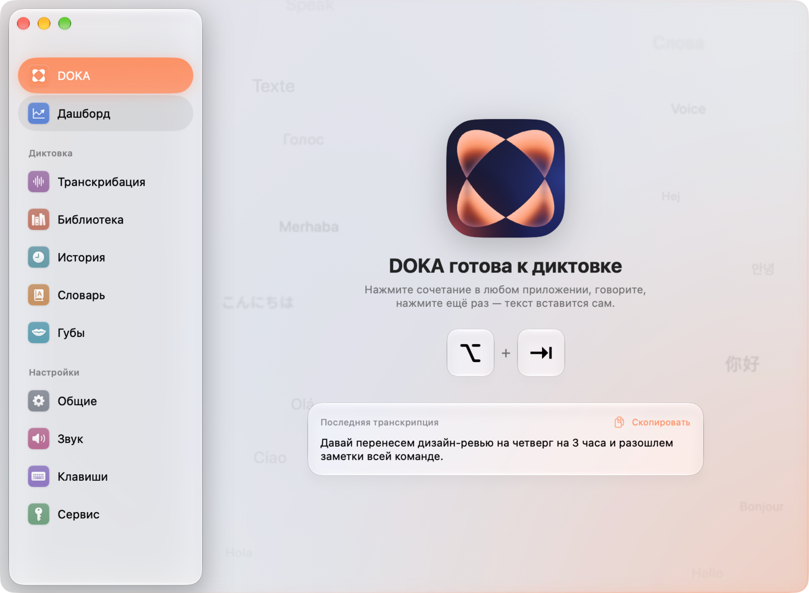
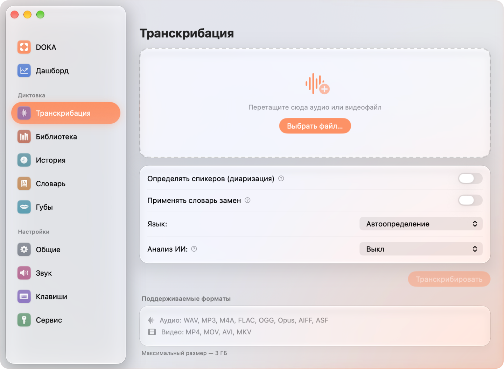
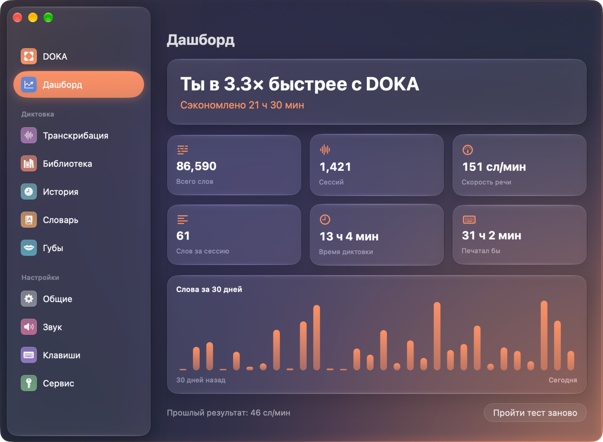
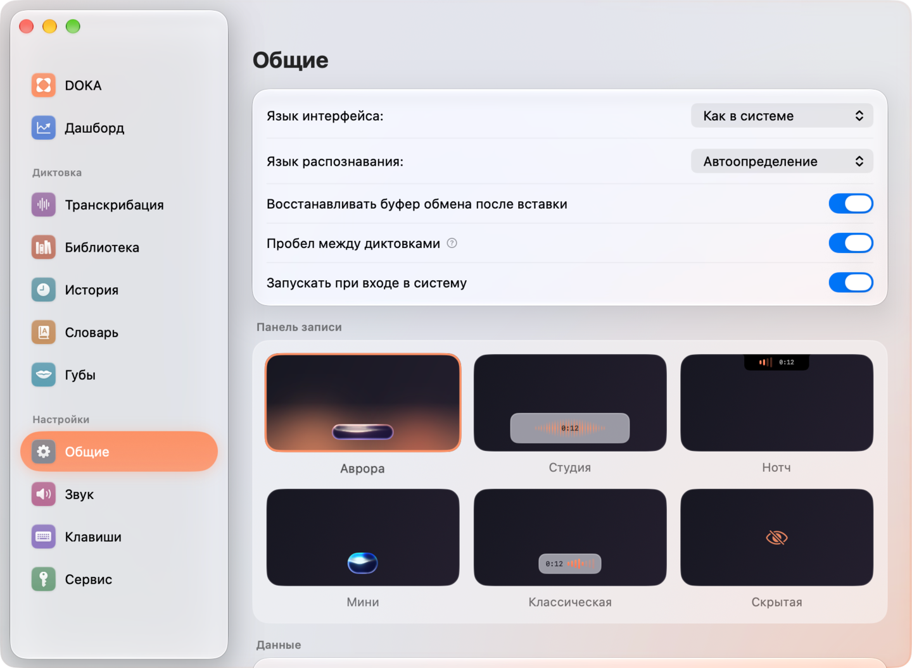

<p align="center">
  
</p>

<h1 align="center">DOKA</h1>

<p align="center">
  <b>Голосовая диктовка и транскрибация для macOS — на вашем Mac, в любом приложении.</b><br>
  Нажмите сочетание, скажите — и текст появится там, где стоит курсор. Приватно по умолчанию.
</p>

<p align="center">
  <a href="README.md">English</a> · <b>Русский</b>
</p>

<p align="center">
  <a href="https://github.com/ippitenin/DOKA-macOS/releases/latest"></a>
  <a href="https://github.com/ippitenin/DOKA-macOS/actions/workflows/build.yml"></a>
  
  
  <a href="LICENSE"></a>
</p>

<p align="center">
  <a href="https://github.com/ippitenin/DOKA-macOS/releases/latest/download/DOKA.dmg"></a>
  <br>
  <sub>Apple silicon · macOS 15 и новее · подписано и нотаризовано Apple</sub>
</p>

<p align="center">
  
</p>

DOKA живёт в меню-баре. Распознавание идёт **целиком на вашем Mac** — Whisper или Parakeet на
Neural Engine, без интернета и без ключа API — или через любой OpenAI-совместимый сервис. Кроме
диктовки, DOKA расшифровывает аудио и видео, разделяет спикеров и пишет протоколы встреч
языковой моделью, которая тоже работает локально.

## Возможности

<table>
  <tr>
    <td width="50%" valign="top">
      <h3>🎙️ Диктовка в любое приложение</h3>
      Сочетание, говорите, ещё раз сочетание — текст вставится туда, где курсор. Работают и push-to-talk, и кнопка мыши.
    </td>
    <td width="50%" valign="top">
      <h3>🔒 Приватно по умолчанию</h3>
      Whisper и Parakeet работают на Neural Engine вашего Mac: без интернета, без ключа, звук не покидает устройство.
    </td>
  </tr>
  <tr>
    <td width="50%" valign="top">
      <h3>🎬 Транскрибация аудио и видео</h3>
      Перетащите файл — получите текст с таймкодами, SRT и VTT. Задачи переживают сон, обрыв сети и даже перезапуск.
    </td>
    <td width="50%" valign="top">
      <h3>👥 Спикеры прямо на Mac</h3>
      Кто что сказал — определяется на вашем Mac: полтора часа разговора примерно за 12 секунд.
    </td>
  </tr>
  <tr>
    <td width="50%" valign="top">
      <h3>🧠 ИИ-анализ на вашем Mac</h3>
      Протокол встречи, краткое содержание, задачи или свой промпт — пишет локальная модель. Экспорт в Markdown и PDF.
    </td>
    <td width="50%" valign="top">
      <h3>📚 Библиотека с плеером</h3>
      Каждая расшифровка хранится со звуком: поиск, переход по клику на таймкод, переименование спикеров, правка строк, экспорт.
    </td>
  </tr>
  <tr>
    <td width="50%" valign="top">
      <h3>🌊 Панель, на которую приятно смотреть</h3>
      Шесть стилей записи во главе с «Авророй» — капелькой Liquid Glass на Metal-шейдерах, волна в которой отвечает голосу.
    </td>
    <td width="50%" valign="top">
      <h3>🤫 Тихий режим</h3>
      Диктуйте шёпотом, когда рядом кто-то спит. DOKA перестаёт принимать шёпот за тишину.
    </td>
  </tr>
</table>

<details>
<summary><b>Все возможности подробно</b></summary>

- **Голосовая диктовка** — глобальный хоткей (или push-to-talk, или кнопка мыши) → запись →
  транскрипция → автозамены по словарю → вставка текста в активное приложение через буфер
  обмена и синтетический ⌘V. Между двумя диктовками подряд в одно поле встаёт пробел —
  слова не слипаются. По желанию — ИИ-обработка на своём Mac: убирает запинки, понимает
  самоисправления («в среду, нет, в четверг»), превращает продиктованные «точку» и «запятую» в
  знаки и выполняет ваши пожелания («с маленькой буквы»). Если конец фразы сказан с
  восклицанием — тон в конце резко падает, — точка в конце становится «!»: по звуку, на любом
  сервисе распознавания.
- **Плавающая панель записи** — шесть стилей. `aurora` и `mini` — светящаяся капля на
  Metal-шейдерах в духе Liquid Glass: волна внутри отвечает на голос и амплитудой, и
  скоростью, стекло преломляет свет у кромки, а на распознавании капля пружиной стягивается
  в кольцо пульсирующих точек. `aurora` — широкая тёплая капля с ореолом и мягкой подсветкой
  нижнего края экрана; `mini` — вдвое уже, в холодной палитре (лёд, бирюза, сине-фиолетовый)
  и с живой кромкой: свет волны вытекает на обводку, бежит по ней приливами и расщепляется
  хроматической аберрацией. Плюс `studio`, `classic`,
  `notch` (плашка, прирастающая к вырезу камеры) и `hidden`.
- **Транскрибация файлов** — перетащите аудио или видео и получите сегменты с тайм-кодами,
  субтитры (SRT/VTT) и, по желанию, разделение по спикерам. У встроенного сервиса задача
  выполняется асинхронно: она переживает обрыв сети, сон Mac и даже перезапуск приложения —
  результат добирается без повторной загрузки файла и повторной оплаты.
- **Разделение по спикерам на своём Mac** — с локальной моделью (или со своим
  OpenAI-совместимым сервисом, у которого диаризации нет вовсе) DOKA разделяет говорящих
  прямо на компьютере моделью NVIDIA Nemotron 3 Diarization: ~220 МБ скачиваются один
  раз, интернет и оплата не нужны. Полтора часа разговора на Apple Silicon разделяются
  примерно за 12 секунд; если знаете, сколько человек говорит, подсказка переключает на
  pyannote — он умеет «ровно столько спикеров».
- **Библиотека транскрибаций** — каждый распознанный файл хранится вместе со звуком:
  поиск по названию и тексту, группы по датам, переименование, пакетный экспорт (одним
  файлом Markdown или .txt либо отдельными TXT/SRT/VTT на запись). Запись открывается с
  плеером: клик по тайм-коду — переход к месту, звучащий фрагмент подсвечен, и лента
  следует за ним; пробел, ←/→ и выбор скорости. Выполняющиеся задачи видны с прогрессом;
  записи хранятся бессрочно, если не выбрать срок.
- **Повтор и повторное распознавание** — неудачную или отменённую задачу можно продолжить
  прямо из записи: если сервер уже досчитал результат (и списал за него деньги), он
  забирается без повторной загрузки файла; иначе файл уходит заново, а платный сервис перед
  этим спрашивает подтверждение. Любую запись можно распознать заново другим сервисом —
  новый результат появляется рядом с исходным, а исходный остаётся на месте. У неудачной
  диктовки появляется свой пункт в меню-баре: почините сеть — и текст всё равно окажется в
  том приложении, где вы работали. Если транскрибация закончится, пока вы смотрите в другое
  окно, придёт уведомление — клик по нему открывает запись.
- **Спикеры и правка текста** — переименование спикеров («Спикер 1» → «Анна»), слияние
  двух спикеров в одного и обратное разделение, переназначение реплики (или части длинной
  реплики) другому спикеру, исправление текста реплики двойным кликом. Правки переживают
  любую детализацию тайм-кодов, попадают в копирование и во все форматы экспорта и
  отменяются по одной или все сразу; исходный результат распознавания не перезаписывается.
  «Угадать имена» — языковая модель на этом Mac находит в разговоре имена говорящих (по
  представлениям и обращениям) и замечает, если одного человека разделили на двух; каждое
  предложение применяется только по вашему подтверждению.
- **ИИ-анализ расшифровки на своём Mac** — протокол встречи, краткое резюме, список задач,
  конспект лекции, интервью, главы или свой запрос. Отчёт пишет языковая модель прямо на
  компьютере (llama.cpp + Qwen3.5 4B): без интернета, без ключа и без оплаты; модель
  2,7 ГБ скачивается один раз. Длинная запись разбирается по частям и сводится в один
  отчёт. Разделы шаблонов можно переписать под себя или собрать свой шаблон; шаблоны
  экспортируются и импортируются файлами JSON, в том числе шаблоны Memento. Результат
  рендерится как оформленный текст с заголовками, списками и таблицами, тайм-коды в нём
  кликабельны и перематывают плеер; копирование кладёт в буфер и обычный текст, и
  форматированный — в Telegram, Notes или Word таблицы вставляются таблицами; отчёт
  сохраняется в Markdown, обычным текстом или в PDF формата A4 с шапкой и номерами страниц.
  Анализ можно заказать сразу при транскрибации файла — любым шаблоном или своим
  запросом: по умолчанию он пишется на этом Mac после распознавания, а у встроенного
  сервиса можно выбрать «В облаке» (языковая модель Nexara) — тогда анализ едет одним
  запросом с распознаванием.
- **История** — журнал диктовок с метаданными, воспроизведением записи, экспортом
  (CSV или текст) и экраном анализа производительности.
- **Дашборд** — сколько слов надиктовано, сколько времени сэкономлено и во сколько раз это
  быстрее вашей собственной печати (измеряется встроенным тестом), плюс график по дням.
- **Обработка звука** — буст громкости микрофона на время записи, удаление тишины перед
  отправкой и системные звуки ключевых переходов.
- **Тихий режим** — диктовка шёпотом, когда рядом спят или нельзя говорить вслух. Шёпот
  распознаётся почти так же точно, как голос, а DOKA перестаёт принимать его за тишину.
  Переключается в «Звуке», из меню в строке меню или своей горячей клавишей.
- **Губы (эксперимент)** — сбор пар «видео губ + текст» для будущего чтения по губам.
  Включается в «Основные → Расширенные» и по умолчанию выключен. Камера работает только
  во время диктовки, а распознанный текст становится подписью к видео. На время записи
  из выреза экрана выплывает зеркало: живой кадр рта, который спокойно следует за лицом, со
  светящейся маской губ в палитре «Авроры» (от персика к индиго) — она лежит ровно на том
  кадре, по которому посчитана. Беззвучные пары звук не разметит, поэтому для них есть окно
  «Тренировка»: на экране фраза — из ваших прошлых диктовок или готового списка, — её нужно
  проговорить одними губами, и подписью становится сам текст фразы. Пока это только сбор
  данных: читать по губам DOKA ещё не умеет.
- **Словарь** — регистронезависимые правила автозамены, применяемые к каждой расшифровке. Правило срабатывает на целое слово: «дока» → «DOKA» больше не портит «документ»; переключатель «Внутри слов» у правила возвращает поиск подстроки (например, «ё» → «е»). По желанию словарь применяется и к расшифровкам файлов.


</details>

## Поближе

<table>
  <tr>
    <td width="33%" valign="top"></td>
    <td width="33%" valign="top"></td>
    <td width="33%" valign="top"></td>
  </tr>
  <tr>
    <td align="center"><sub>Транскрибация аудио и видео</sub></td>
    <td align="center"><sub>Насколько быстрее, чем печатать</sub></td>
    <td align="center"><sub>Шесть стилей панели записи</sub></td>
  </tr>
</table>

## Приватность

Три режима распознавания отличаются тем, что покидает ваш Mac:

| Режим | Что уходит с вашего Mac |
|---|---|
| Локальные модели (Whisper, Parakeet) | **Ничего.** Звук не покидает устройство, ключ не нужен — включая разделение по спикерам и ИИ-анализ расшифровки |
| Встроенный сервис (Nexara) | Аудио загружается на `api.nexara.ru` для распознавания |
| Свой OpenAI-совместимый сервис | Аудио загружается на указанный вами адрес |

Всё остальное остаётся локальным. История расшифровок, статистика и библиотека транскрибаций
(со сжатым звуком распознанных файлов — отключается в «Основные → Расширенные») лежат в
`~/Library/Application Support/DOKA`. Сохранение аудио диктовок **по умолчанию
выключено**; если включить, записи хранятся локально в m4a и удаляются по выбранному сроку.
Ключи API живут в Keychain macOS, а не в файлах настроек.

Эксперимент «Губы» снимает лицо, только если вы сами его включили. Видео лица — биометрические
данные: они хранятся в `~/Library/Application Support/DOKA/LipData`, никуда не отправляются
и сами не удаляются. Всё можно стереть одной кнопкой в разделе «Губы».


## Сервисы распознавания

Выбираются при первом запуске или позже в разделе **«Сервис»**:

| Сервис | Ключ API | Особенности |
|---|---|---|
| Whisper Large v3 Turbo (Local) | не нужен | разовая загрузка ~1,6 ГБ, работает через WhisperKit на Neural Engine |
| Parakeet TDT 0.6B v3 (Local) | не нужен | ~700 МБ, работает через FluidAudio |
| Встроенный (Nexara) | нужен | добавляет тип записи, роли спикеров, ИИ-анализ и async-режим |
| Свой сервис | нужен | любой OpenAI-совместимый эндпоинт `/audio/transcriptions` |

Разделение по спикерам и ИИ-анализ работают с любым сервисом: то, чего сервис не делает сам,
выполняется на вашем Mac.

## Установка

1. Скачайте **[DOKA.dmg](https://github.com/ippitenin/DOKA-macOS/releases/latest/download/DOKA.dmg)** из последнего релиза.
2. Откройте его и перетащите DOKA в «Программы».
3. Запустите — DOKA появится в меню-баре. Первый запуск проведёт через три шага: доступ к
   **микрофону** для записи, **универсальный доступ** для вставки текста и выбор сервиса
   распознавания — облачного с ключом или локальной модели, которую можно скачать прямо там.

**Требования:** Mac с чипом Apple (M1 и новее) и macOS 15 или новее. Локальному ИИ-анализу
нужно около 2,7 ГБ на диске и до 5 ГБ памяти на время работы.

## Сборка из исходников

```bash
git clone https://github.com/ippitenin/DOKA-macOS.git
cd DOKA-macOS/DOKA-app
./build.sh        # собирает DOKA и устанавливает в ~/Applications
```

Для сборки нужен Xcode 26 или новее. Тесты, соглашения и как поучаствовать — в
[CONTRIBUTING.ru.md](CONTRIBUTING.ru.md).

## Благодарности и лицензии зависимостей

Полный список с версиями и обязательными уведомлениями — в [`THIRD_PARTY_LICENSES.md`](THIRD_PARTY_LICENSES.md).

- [KeyboardShortcuts](https://github.com/sindresorhus/KeyboardShortcuts) — MIT
- [llama.cpp](https://github.com/ggml-org/llama.cpp) — MIT (готовый xcframework, едет
  внутри `DOKA.app/Contents/Frameworks`)
- [WhisperKit / argmax-oss-swift](https://github.com/argmaxinc/argmax-oss-swift) — MIT
- [FluidAudio](https://github.com/FluidInference/FluidAudio) — Apache-2.0
- код Hub и Tokenizers из [swift-transformers](https://github.com/huggingface/swift-transformers)
  (встроен в argmax-oss-swift) и `swift-argument-parser` от Apple — Apache-2.0

Модели скачиваются пользователем во время работы и в репозиторий не входят:

- [Whisper large-v3-turbo](https://huggingface.co/openai/whisper-large-v3-turbo) от OpenAI — MIT
- [Parakeet TDT 0.6B v3](https://huggingface.co/nvidia/parakeet-tdt-0.6b-v3) от NVIDIA — CC-BY-4.0
- [Qwen3.5-4B](https://huggingface.co/Qwen/Qwen3.5-4B) от Alibaba Cloud — Apache-2.0
  (GGUF-квантование — [lmstudio-community](https://huggingface.co/lmstudio-community/Qwen3.5-4B-GGUF))

## Лицензия

[GPL-3.0](LICENSE) © Илья Питенин
